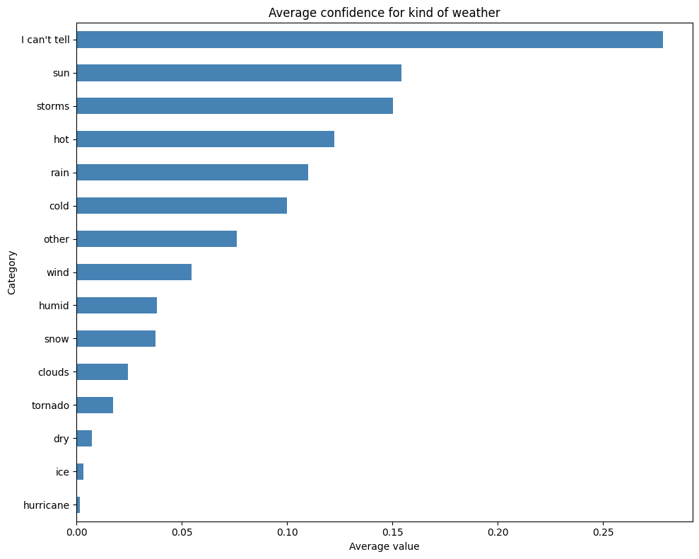
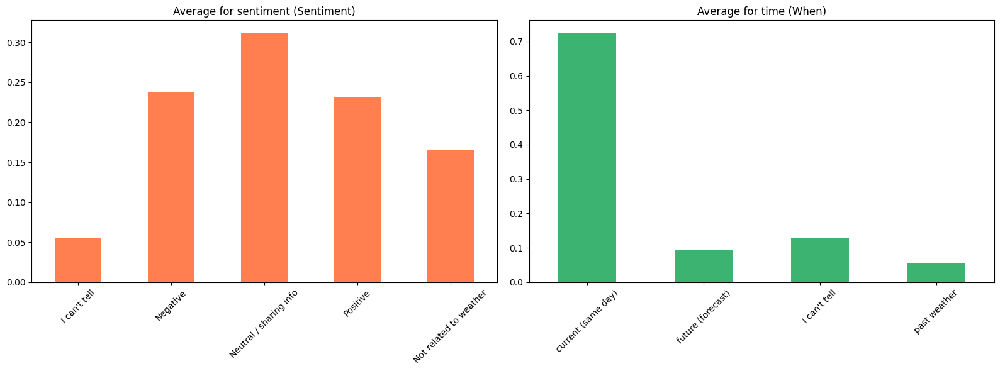
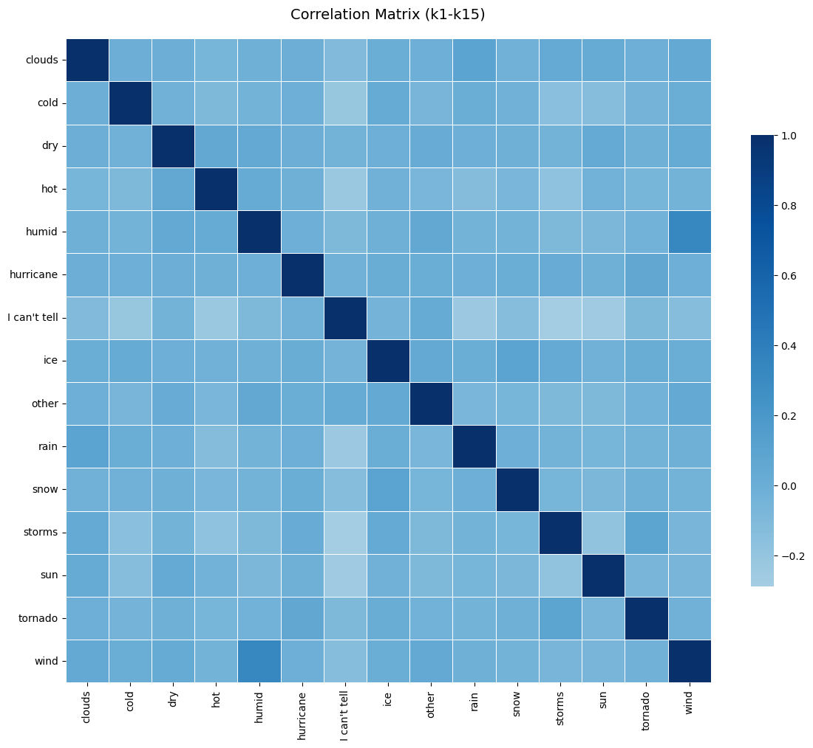
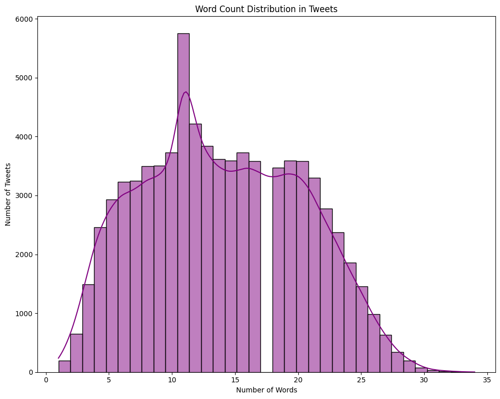
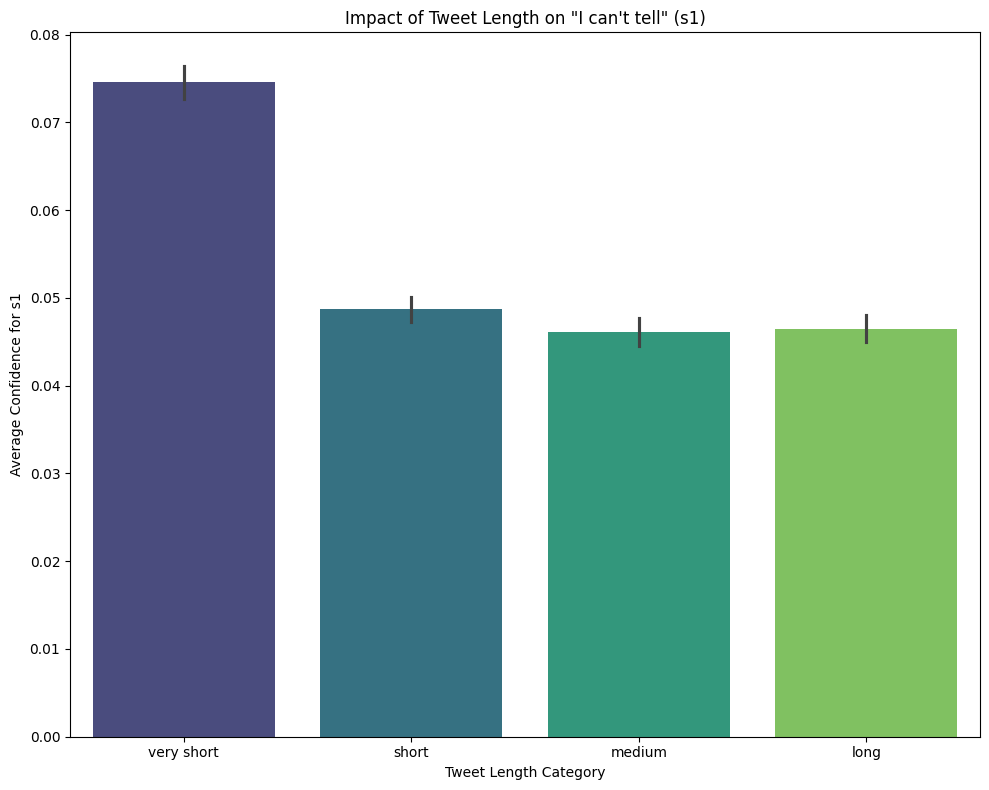
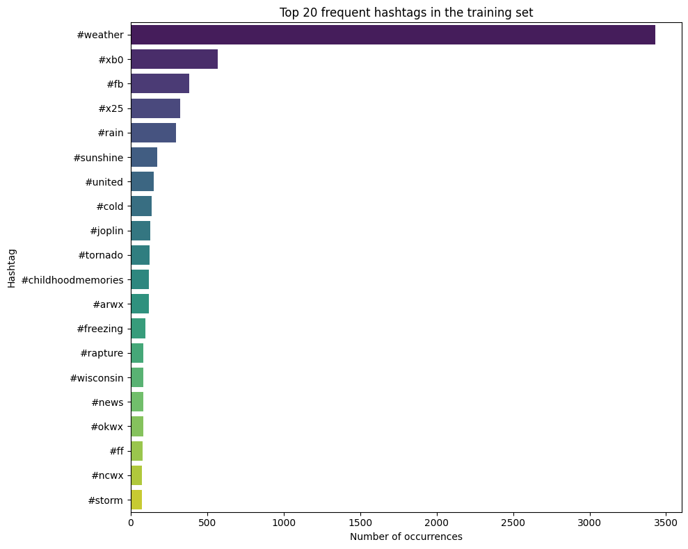

# Partly Sunny with a Chance of Hashtags
## Overview
This repository contains a solution for the Kaggle competition "Partly Sunny with a Chance of Hashtags," hosted in partnership with CrowdFlower. The challenge revolves around analyzing a dataset of weather-related tweets to extract multiple layers of information from just a few characters. Technically, this is a Natural Language Processing  and Multi-Target Regression problem, as the objective is to predict continuous confidence scores for multiple classes simultaneously rather than assigning hard binary labels.

## Goal
The main objective is to analyze each tweet and predict the confidence score (ranging from 0 to 1) for 24 distinct labels. The evaluation metric for the competition is the Root Mean Squared Error (RMSE).

The 24 labels are divided into three categories:

- Sentiment (s1-s5): Measures the sentiment of the tweet (e.g., Positive, Negative, Neutral, I can't tell, Not related).
- When (w1-w4): Determines the time frame referenced (e.g., Current, Future, Past, I can't tell).
- Kind (k1-k15): Specifies the exact weather phenomenon mentioned (e.g., clouds, cold, rain, tornado, hurricane).

## Dataset Description
The dataset consists of a training set and a test set containing tweets and metadata:
- Train Set: 77,946 rows. Contains id, tweet, state, location, and 24 columns representing the confidence 
- Test Set: 42,157 rows. Contains id, tweet, state, and location.

Missing Data: A preliminary check revealed that the state column in the test set is missing ~66% of its values, and location also contains missing data. Because of this, these metadata columns were deemed unreliable for modeling.

## Data cleaning
To prepare the data for machine learning algorithms, the following cleaning steps were applied to the dataset:

1. Dropping Metadata: The state and location columns were completely removed from both the train and test sets to focus solely on the text data.
2. Text Preprocessing: A custom regex-based cleaning function was applied to the tweet column:

    - Converted all text to lowercase.
    - Removed all URLs (e.g., {link}, http://...).
    - Removed user mentions (e.g., @mention, @user).
    - Removed the # symbol from hashtags but kept the hashtag text, as it contains highly relevant weather information.
    - Removed special characters and punctuation.
    - Stripped multiple whitespaces.

## Exploratory Data Analysis (EDA)

A comprehensive Exploratory Data Analysis was conducted to understand the underlying patterns in the text and target variables:
- **Target Distribution**: The distribution of weather phenomena (k1-k15) is heavily imbalanced. "I can't tell" is the most frequent label, while extreme weather events like "hurricane" and "tornado" are extremely rare (long-tail distribution). Most tweets are labeled as "Neutral / sharing info" (Sentiment) and "current weather" (When).

<figure align="center">
  
</figure>

<figure align="center">
  
</figure>

- **Correlation:** A correlation matrix of the weather phenomena (k1-k15) showed very weak linear relationships overall. There are minor, logical positive correlations (e.g., between "hot" and "humid"), but the overall independence of the targets supports using models that treat each target separately.

<figure align="center">
  
</figure>

- **Tweet Length Impact:** An analysis of word counts revealed that the vast majority of tweets are between 5 and 20 words long. Interestingly, "very short" tweets show a noticeably higher average confidence score for the s1 ("I can't tell") category, making tweet length a potentially valuable feature.

<figure align="center">
  
</figure>

<figure align="center">
  
</figure>

- **Hashtag Analysis:** Extracting the top 20 most frequent hashtags showed #weather as the absolute leader. While some noisy tags were present (#xb0, #fb), many highly predictive tags were frequently used (e.g., #rain, #cold, #tornado), validating the decision to keep the hashtag text during the cleaning phase.

<figure align="center">
  
</figure>

## Next step: Baseline